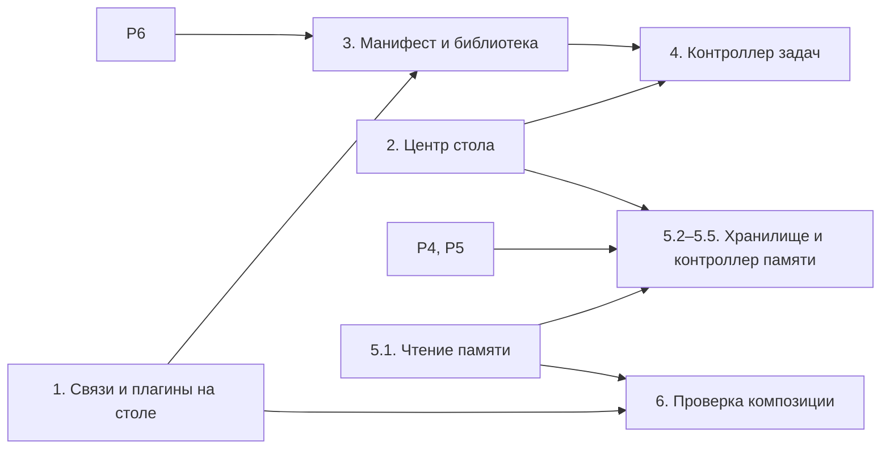

# План внедрения аксиом конструктора

> Уровень: **Куда двигаться**. Статус: **черновик, 2026-10-27**. Основание — [`axioms.md`](./axioms.md) и решение [D24](../07-decisions/README.md#d24-аксиомы-конструктора-агента). Состояние кода — коммит `117caa8`, фазы 1–2 и шаг 5.1 (2026-10-27).
> План не пересматривает аксиомы. Исключение — Р1 (2026-10-27): в аксиомах 8–11 «экшен» заменён на «команду», модель не менялась. Р2 тоже принят: навык из библиотеки копируется в агента. Порядок фаз и решения Р3–Р6 пересматривать можно.

## 1. Где мы сейчас

**Есть** — работает. **Частично** — основа есть, не хватает куска. **Нет** — не начато.

| Аксиома | Статус | Что есть в коде | Чего не хватает |
|---|---|---|---|
| 1. Агент — исполняемая система | Есть | Черновик и публикации. Runtime исполняет опубликованного агента: worker, Skill Run, ожидание и возобновление. Центр стола показывает опубликованную версию, отличается ли от неё черновик и прогоны по статусам (фаза 2) | — |
| 2. Ядро, рантайм, конфигурация | Частично | Конфигурация — документ агента. Рантайм — worker, шина событий, исполнение FSM. Роль ядра делят диспетчер актов, выбор навыка и `RuntimeService` | Соответствие частей нигде не записано. Внутреннее устройство аксиома не фиксирует |
| 3. Контроллеры задач и памяти | Частично | Функции контроллера задач разнесены: `runtime/dispatcher.py` классифицирует акт таблицей правил без LLM, `runtime/skill_resolver.py` выбирает навык по переходам из initial и `defaultSkillId`. LLM выбирается только на инстансе `polza_ai_llm` для шагов рецепта | Контроллер задач как один компонент. Контроллер памяти. Выбор LLM контроллеров в настройках агента |
| 4. Каналы | Есть | Ось мира на столе: Telegram и Web Client, адреса, светофор кабеля и адреса ([`constructor-world-axis.md`](../03-architecture/constructor-world-axis.md)) | — |
| 5. Навык — поведение в отдельном конструкторе | Есть | Навык — FSM, редактор холста в разделе Skills. На столе — колонка навыков | — |
| 6. Навыки с нуля и из библиотеки | Частично | Новый навык создаётся на столе и в разделе Skills. YAML-пакет навыков импортируется в одного агента (`SkillsImportDialog.vue`). Шаблоны целых агентов — `backend/scenarios/` | Общей библиотеки навыков нет. Подключение из неё будет копией (Р2) |
| 7. Манифест навыка | Нет | У навыка есть `name`, `description`, `version`, `params`, `states`. Стартовые события и используемые Actions выводятся из автомата | Формата нет. Выбор навыка смотрит только на переходы из initial |
| 8. Плагины, предоставляющие команды | Частично | Каталог типов на сервере (`GET /api/tools/catalog`): команды, события, схема настроек. Реализация регистрируется вручную. 7 из 12 типов — манифест без исполнения, помечены `implemented: false`: их нельзя добавить или включить ([`REVIEW.md`](../REVIEW.md) 3.1) | — |
| 9. Навыки используют команды плагинов через Actions | Есть | Навык → id Action → шаг рецепта → команда инстанса. Цепочку проверяет валидация. На столе она видна в панелях навыка, канала и плагина и в подсветке (фаза 1) | — |
| 10. Плагин без навыка | Есть | Инстанс включается без использования: это предупреждение, не ошибка. Плагин без навыка на столе зелёный. Канал без навыка горит жёлтым | — |
| 11. Зависимости готового навыка | Частично | Импорт YAML показывает недостающие Action id | Нет проверки плагинов и их подключения. Actions переносятся вместе с навыком |
| 12. Своя память у агента | Нет | — | — |
| 13. Память — подсистема с LLM-контроллером | Нет | Тип `memory` в каталоге: команда `search` без исполнения | Хранилище, операции, контроллер |
| 14. Пять типов памяти | Частично | Данные трёх типов из пяти уже лежат в системе под другими именами (таблица ниже) | Долговременная память и предметные знания |
| 15. Прозрачность памяти | Частично | Верхняя зона стола и раздел «Память»: история событий агента и рабочее состояние прогонов — состояние, `params`, `vars` без служебных ключей. Кокпит по-прежнему показывает путь одного прогона | Поиск и правка. Контекст взаимодействия, долговременная память и предметные знания на экран не выведены |

### Типы памяти и данные, которые уже есть

| Тип | Что лежит в системе | Видно человеку |
|---|---|---|
| Контекст текущего взаимодействия | `conversation_id`; снимок стола веб-клиента, который `runtime/desk.py` подмешивает в `vars` перед обработкой | Нет |
| История событий | Журнал событий прогона, Action Run, Tool Execution (`/api/runtime/runs/{id}/history`); вызовы внешних API (`tool_api_logs`) | Да. По агенту — верхняя зона и раздел «Память» (`GET /api/runtime/agents/{slug}/memory`). По одному прогону — кокпит и Logs |
| Долговременная память | Нет | — |
| Предметные знания | Нет. Правда дела живёт на столе веб-клиента (D14) | — |
| Рабочее состояние | `current_state`, `params`, `vars` прогона в `skill_runs` | Да: состояние, `params` и `vars` без ключей с `_`. В карточке прогона кокпита — тоже |

### Зоны стола

| Зона (принцип 2) | Сейчас |
|---|---|
| Центр — агент | Есть: круг → карточка → детали, со статусом публикации и прогонов |
| Слева — каналы | Есть, с адресами и светофором |
| Справа — навыки | Есть |
| Снизу — инструменты | Есть: плагины без `world`, каталог, светофор |
| Сверху — память | Есть: карточка над агентом и раздел «Память». Читаются история событий и рабочее состояние. Долговременной памяти и предметных знаний нет |
| Связи между зонами (принцип 4) | Есть: «Что нужно навыку», «Где используется», подсветка при выборе. Пунктир от навыка к агенту по-прежнему без смысла |

## 2. Что аксиомы меняют в прежних решениях

Записано в [D24](../07-decisions/README.md#d24-аксиомы-конструктора-агента). Слои 02–04 описывают код как есть и меняются вместе с кодом своей фазы.

| Решение | Было | Стало |
|---|---|---|
| D2 | Память — Tool с командами `search`, `propose`, `store` | Память — подсистема агента со своим контроллером (аксиома 13) |
| D13 | Диспетчер актов — таблица правил без LLM | Таблица правил остаётся первой версией. Контроллер задач, частью которого она станет, работает с LLM, выбранной пользователем (аксиома 3) |
| D20 | Без Session, Context Manager и Task Manager | Контроллеры задач и памяти — системные компоненты агента. Session не вводится. Контекст взаимодействия — тип памяти (аксиома 14) |
| D21 | Planner вне scope | Список задач формирует контроллер задач по манифестам навыков (аксиома 7). Алгоритм открыт |

Не меняются: D6 — Action остаётся рецептом из команд плагина (Р1). D9 — LLM не выбирает шаг внутри навыка: контроллер выбирает навык, автомат — шаги. D14 — правда дела живёт на столе; граница с предметными знаниями — Р4. D7 и D16 — тип плагина отделён от его подключения к агенту, каталог живёт на сервере.

## 3. Решения до кода

Вопросы раздела 7 аксиом остаются открытыми. Здесь — то, что всплыло при сверке с кодом и блокирует конкретные фазы.

### Р1. Что плагин предоставляет

**Принято 2026-10-27.** В аксиомах 8–11 слово «экшен» было оговоркой: имелась в виду команда плагина. Action остаётся рецептом из команд, который собирает сам агент (D6). Навык ссылается на id Action и не вызывает команду напрямую ([`rules.md`](../02-domain/rules.md), правило A1). Варианты переименовать команду в экшен или убрать раздел Actions сняты. Записано в [D24](../07-decisions/README.md#d24-аксиомы-конструктора-агента).

### Р2. Навык из библиотеки — копия или ссылка

**Принято 2026-10-27: копия.** Один и тот же навык библиотеки используют многие агенты, у каждого своя копия. Агент правит её свободно: библиотека и остальные агенты от этого не меняются. На копии записаны источник и версия. Обновление из библиотеки — отдельный жест с показом разницы; само оно не приходит. Публикация агента закрепляет уже скопированный навык (D10). Это ответ на вопрос 5 из [`spatial-model.md`](./spatial-model.md) в части навыка. Записано в [D24](../07-decisions/README.md#d24-аксиомы-конструктора-агента).

### Р3. Канал — это плагин?

В коде канал — плагин с флагом `world`: у Telegram и Web Client есть команды `send_message` и `get_snapshot`. Аксиомы описывают каналы (4) и плагины (8) отдельно, принцип 2 разводит их по разным зонам.

Предложение: канал стоит на столе один раз, слева. Его команды перечислены в панели канала, связь «навык → Action → команда → канал» ведёт в левую зону. Нижняя зона — плагины без `world`.

Блокировало фазу 1. Фаза 1 сделана по предложению как по рабочему допущению. Другое решение переделает нижнюю зону и деление на каналы и плагины в панелях.

### Р4. Предметные знания и стол

Аксиома 14 кладёт в память сведения о материалах, сотрудниках, правилах. D14 держит правду дела на столе веб-клиента: runtime — не учётная система.

Гипотеза: память хранит то, чем агент рассуждает, — справочные сведения, правила, опыт. Учётные записи, правда о которых живёт на столе, в память не копируются. Если сведение пришло со стола, при нём хранится источник. Пример из [`direction.md`](./direction.md): правила и эпизоды правок письма хранит агент, а сам фактор — СОУС.

Блокирует: фазу 5, шаги 2–5.

### Р5. Как навык обращается к памяти

- **(а)** Через команды системного плагина памяти: навык явно ищет и сохраняет.
- **(б)** Контроллер памяти сам подкладывает нужное перед шагом и сам сохраняет итоги.
- **(в)** Оба способа.

Аксиома 13 говорит о специализированных операциях — это ближе к (а) или (в). Заглушку `memory` в каталоге заменит системный плагин, или она уйдёт.

Блокирует: фазу 5, шаг 4.

### Р6. Минимальный манифест

Предложение: начать с полей, которые выводятся из самого навыка, — стартовые и ожидаемые события, Actions, команды и плагины за ними, `params`. Добавить два авторских поля: зачем навык и чем он заканчивается. До контроллера задач манифест — справка для человека и основа проверки зависимостей. Формат дополняется вместе с алгоритмом выбора навыка.

Блокирует: фазы 3 и 4.

## 4. Фазы

Фазы 1 и 2 и первый шаг фазы 5 сделаны на текущей модели. Р1 и Р2 закрыты. Фазу 3 держит Р6, шаги 5.2–5.5 — Р4 и Р5.

### Фаза 0. Документы и решения

- [x] Аксиомы в [`axioms.md`](./axioms.md), решение D24, пометки в D2, D13, D20, D21, `goals.md`, `research-questions.md`, `vision.md`, ссылки в [`README.md`](../README.md).
- [x] Р1 принят и записан в D24. Шпаргалки не менялись: цепочка Agent → Skills / Actions / Tools совпадает с поправленными аксиомами.
- [x] Р2 принят и записан в D24: навык из библиотеки копируется в агента.
- [ ] Принять Р3 и записать его в журнал решений.

### Фаза 1. Связи и плагины на столе

Аксиомы 8–10, принципы 2 и 4. Новая модель данных не нужна: всё выводится из документа агента.

1. Панель навыка показывает, какие Actions он использует (переходы и `onEnter`) и какие плагины и каналы за ними стоят. Тот же обход документа, что в `validateAgent.ts`.
2. Нижняя зона стола: подключённые плагины без `world`. У каждого — какие команды он предоставляет и какие навыки этим пользуются. «Добавить» открывает каталог плагинов по образцу листа каналов. Плагин без навыка — нормальное состояние (аксиома 10).
3. Выбор навыка подсвечивает его плагины и каналы. Выбор плагина подсвечивает навыки, которые от него зависят.
4. Каталог не предлагает плагины без реализации, а включённый неисполнимый плагин — ошибка валидации на сервере и в UI ([`REVIEW.md`](../REVIEW.md) 3.1). Иначе фаза 3 подключит неисполнимую зависимость.
5. Дописать нижнюю зону в [`constructor-world-axis.md`](../03-architecture/constructor-world-axis.md).

Готово, когда: на агенте `sous-letter` видно, что `compose_letter` зависит от Web Client и `polza_ai_llm`, без захода в раздел Actions.

**Сделано 2026-10-27**, все пять пунктов; Р3 — рабочее допущение. На `sous-letter` панель `compose_letter` показывает канал Web Client, плагин PolzaAI_LLM и цепочки четырёх Actions.

### Фаза 2. Центр стола: агент исполняется

Аксиомы 1–2, принцип 1, открытый вопрос «Центральный блок».

1. В карточке и деталях агента: опубликованная версия, новее ли черновик, прогоны по статусам — идут, ждут, с ошибкой. Данные уже есть: `GET /api/runtime/agents/{slug}/summary` и `GET /api/agents/{slug}/publications`.
2. Из центра — переходы в Overview (готовность к публикации) и Runtime (прогоны).
3. Детали агента делятся на «Конфигурацию» (что задано) и «Исполнение» (что происходит).

Не делать: выбор LLM контроллеров до появления самих контроллеров. Настройка, которую никто не читает, обманывает пользователя.

Готово, когда: по центру стола видно, работает ли агент и что с ним сейчас происходит, без перехода в кокпит.

**Сделано 2026-10-27.** Данных хватило не полностью: сводка агента получила `latestPublishedAt` и `draftChanges` — части, читаемые runtime, которые черновик меняет относительно последней публикации. Раскладка редакторов, время и адреса мира изменением не считаются ([`constructor-world-axis.md`](../03-architecture/constructor-world-axis.md#agent-in-the-center)). На `sous-letter` центр показывает «Черновик новее 0.1.1», изменённые плагины и каналы и один ждущий прогон.

### Фаза 3. Манифест и библиотека навыков

Аксиомы 6, 7, 11. Нужны Р6 и фаза 1. Подключение из библиотеки копирует навык (Р2).

1. Выводимый манифест в панели навыка, только чтение. Сервер и UI считают его одной реализацией, без второго порта правил, как вышло с валидацией ([`rules.md`](../02-domain/rules.md), правило F4).
2. Авторские поля манифеста по Р6.
3. Библиотека навыков на сервере: хранение с версиями, список, «положить навык агента в библиотеку», «подключить из библиотеки». Подключение кладёт в агента копию и помечает источник и версию. Формат — развитие YAML-пакетов из `skillPackImport.ts`.
4. Подключение из библиотеки проверяет зависимости: каких Actions и плагинов не хватает. Actions переносятся вместе с навыком, недостающие плагины подключаются. Человек видит, какие ключи заполнить; остальное подсказывает светофор плагинов и каналов.
5. Диалог «Добавить навык» на столе получает два пути: «Новый» и «Из библиотеки».

Готово, когда: `compose_letter` ставится в пустого агента из библиотеки, E.V.A. сама подключает Web Client и `polza_ai_llm` и просит только ключи. После ключей валидация проходит.

### Фаза 4. Контроллер задач

Аксиомы 3 и 7. Нужны фазы 2 и 3 и отдельный проектный документ: алгоритм — открытый вопрос аксиом.

1. Свести диспетчер актов и выбор навыка в один компонент без смены поведения. Выбор навыка читает манифесты, а не только переходы из initial; `defaultSkillId` становится частным случаем.
2. Решение контроллера записывается отдельно, тип события не переписывается. Это снимает единственное нарушение правила «событие — факт, а не команда» ([`rules.md`](../02-domain/rules.md), правило B1).
3. Список задач виден человеку: что контроллер запустил, продолжил, отклонил и почему.
4. LLM включается там, где правил не хватает: неоднозначный выбор, `underspecified`. Модель выбирается в центре стола. Шаги внутри навыка по-прежнему выбирает автомат (D9).

Готово, когда: сценарий D из [`spatial-model.md`](./spatial-model.md) — несколько навыков, разные события — проходит, и причина выбора навыка видна человеку.

### Фаза 5. Память

Аксиомы 12–15, принцип 5. Шаг 1 не ждёт решений. Шаги 2–5 ждут Р4, Р5 и проектного документа контроллера памяти.

1. **Чтение того, что уже есть.** Верхняя зона стола и раздел памяти: история событий агента и рабочее состояние его прогонов — состояние, `params`, `vars`. API прогона начинает отдавать `vars` и `params` без служебных ключей.

   **Сделано 2026-10-27.** `GET /api/runtime/runs/{id}` отдаёт `params` и `vars` без ключей на `_`. `GET /api/runtime/agents/{slug}/memory` собирает историю событий агента и рабочее состояние прогонов: сначала идущие и ждущие, затем последние завершённые. На столе карточка «Память» над агентом открывает ту же сводку; раздел — `/:slug/memory`. Правки нет.
2. **Хранилище** долговременной памяти и предметных знаний, своё у каждого агента. Просмотр, поиск, добавление, правка и удаление вручную, без контроллера.
3. **Правила правки по типам.** История только дополняется. Рабочее состояние правится только у ждущего прогона, с проверкой `revision` и записью, кто что поменял. Контекст взаимодействия живёт, пока живёт разговор.
4. **Операции памяти для навыков** по Р5.
5. **Контроллер памяти на LLM:** что извлекать, сохранять, обновлять. Модель выбирается в центре стола.

Готово, когда: человек находит, что агент «знает» о материале, исправляет это, и следующий прогон навыка работает с исправленным.

### Фаза 6. Проверка композиции

Принципы интерфейса — гипотеза, открытый вопрос «Компоновка».

1. Когда на столе появятся все пять зон (после фазы 1 и первого шага фазы 5), прогнать `foreman`, `sous-letter` и синтетического агента с десятком навыков и плагинов. Записать, где стол перестаёт читаться и нужны свёртка или поиск.
2. Сценарии A–E из [`spatial-model.md`](./spatial-model.md) — общий приёмочный набор для фаз 3–5.

## 5. Чего не делать раньше времени

- Не рисовать контроллеры на столе отдельными узлами (принцип 3).
- Не добавлять настройки, которые не читает рантайм: выбор LLM появляется вместе с контроллером.
- Не проектировать хранилище памяти до Р4, иначе память станет второй копией стола.
- Не заменять FSM. Аксиома 5 — «действия и переходы между ними» — описывает и нынешний автомат.

## 6. Как вести план

Принятое решение Р — запись в [журнале решений](../07-decisions/README.md) и пометка в разделе 3. Закрытая фаза — отметка здесь, обновлённая таблица раздела 1 и правка слоёв 02–04 под новый код.
