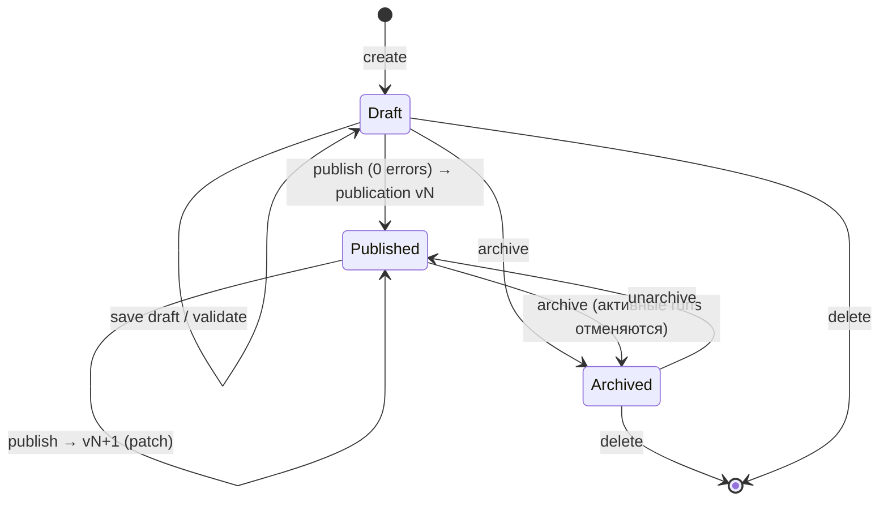
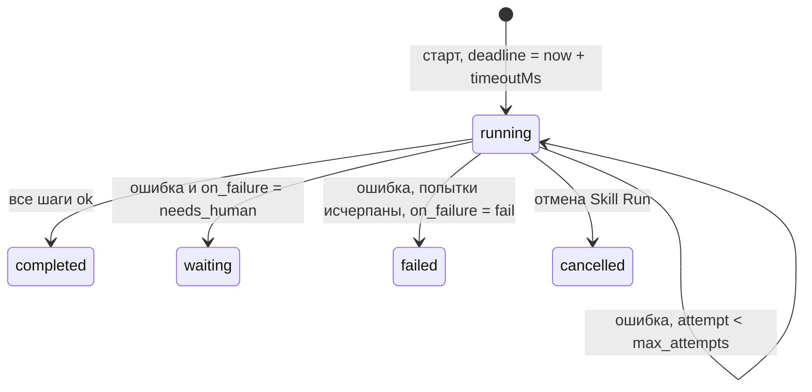
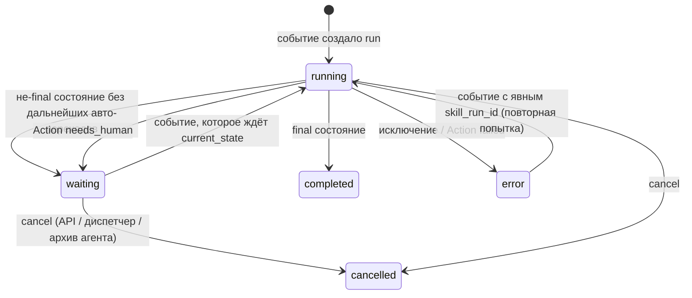
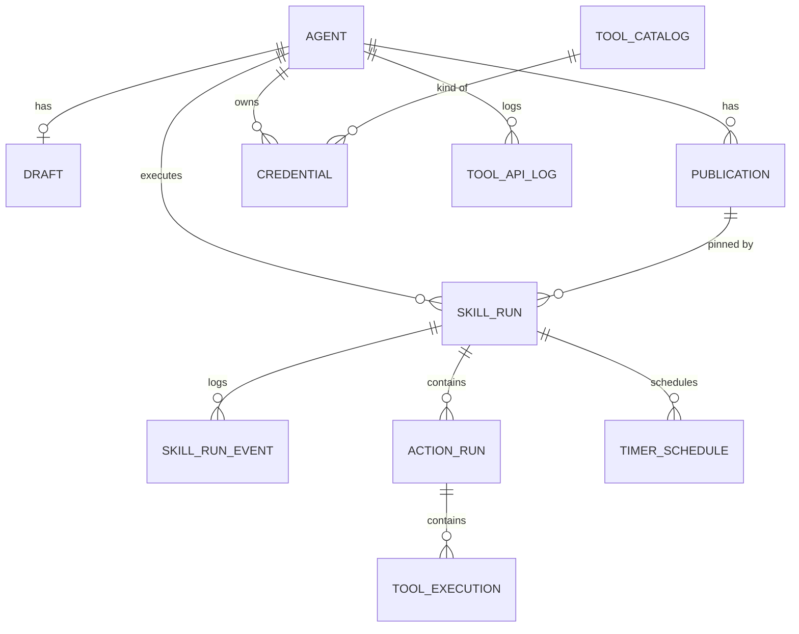

# Entities — сущности, свойства, состояния

> Уровень: **Из чего**. Поведение описано по коду; поля даны в терминах документа агента (camelCase, как в API/UI) и runtime-сущностей. Где спека `docs_old/` и код расходятся — отмечено.

## 1. Agent

**Что это.** Единица проектирования и публикации. Агент владеет своими Skills, Actions, инстансами Tools и credentials; у него есть один черновик и список публикаций.

**Свойства.** `slug` (уникальный, нижний регистр), `name`, `description`, `defaultSkillId` (подсказка маршрутизации), `skills[]`, `actions[]`, `tools[]` (инстансы), `createdAt`, `updatedAt`, `archivedAt`.

**Состояния.**

- **Draft** — всегда существует после создания (пустое тело: `skills/actions/tools = []`).
- **Published** — есть ≥1 публикации. Публикация — неизменяемый снимок `body`; версия начинается с `0.1.0`, далее автоинкремент patch. Runtime использует последнюю публикацию для новых run и **закреплённую** версию для существующих.
- **Archived** — агент скрыт из списка, запрещены редактирование/публикация/новые run (HTTP 409); при архивации все активные run (`running`/`waiting`) отменяются. Публикации сохраняются.

**Инварианты.** Slug уникален. Публикация возможна только без ошибок валидации. Удаление каскадно удаляет черновик, публикации, credentials, логи инструментов.

**Служебное.** Агенты со slug `eva-test-*`, `test-agent-*`, `web-agent-*`, `cred-agent-*` считаются эфемерными (остатки интеграционных тестов) и удаляются при старте, если включено `EVA_PRUNE_EPHEMERAL_AGENTS`.

## 2. Skill

**Что это.** Процесс класса задач, описанный конечным автоматом. Один Skill — один автомат.

**Свойства.** `id`, `name`, `description`, `version` (SemVer, по умолчанию `0.1.0`), `initial` (id начального состояния; если пуст — первое состояние), `params[]` (`name`, `type` ∈ string/number/boolean/object/array, `required`), `states[]`, геометрия холста (`x/y/width/height` состояний, `viewport`, `flowDirection`).

**Params vs vars.** `params` — объявленные входы процесса (намерение при старте); `vars` — изменяемое состояние конкретного run. **Fact:** `params` наполняются из payload стартового события и correlation-полей; `required` в коде не проверяется при старте (валидации отсутствия нет) — см. REVIEW.

## 3. State и Transition

**State.** `id` (уникален в Skill), `name` (человеческое), `onEnter[]` (id Actions, исполняемых при входе), `final`, `transitions[]`.

**Transition (handler).** `event` (тип события), `guard` (строка-условие; пустая = всегда истина), `actions[]` (id Actions), `to` (id целевого состояния). Несколько handler-ов на один event допустимы: проверяются **по порядку**, срабатывает первый с истинным guard.

**Семантика состояния.**

| Состояние | Признак | Что делает runtime |
|---|---|---|
| Начальное | `id == initial` | Здесь создаётся новый run; переход из него по стартовому событию |
| Промежуточное с выходом | есть transitions | Ждёт событие одного из типов в transitions |
| Ожидание | не `final`, transitions есть, но текущее событие не подходит | run остаётся `waiting`, событие пропущено (no-match не ошибка) |
| Тупик | не `final`, нет transitions и onEnter | Валидация: предупреждение `dead_end_state`; run зависнет в `waiting` |
| Финальное | `final: true` | run → `completed`; дальнейшие события игнорируются |

**Порядок применения перехода (Fact):** actions перехода → смена `current_state` (+ запись в history) → `onEnter` нового состояния → синтез событий `action.<id>.completed` для всех выполненных операций → их обработка в том же шаге (до 64 вложенных событий). Спека RUNTIME §10 описывает тот же порядок с явным «persist run» в конце — в коде run сохраняется после обработки всей цепочки.

## 4. Action

**Что это.** Именованная операция агента; FSM видит только её id и результат, не внутренние шаги.

**Свойства.** `id`, `name`, `description`, `version`, `policy` (`auto` | `needs_human`), `inputSchema` / `outputSchema` (произвольный JSON-объект; **Fact:** runtime их не применяет), `recipe[]`, `retry` (`{max_attempts}`), `timeoutMs`, `onFailure` (`fail` | `needs_human` | `retry`; по умолчанию `needs_human` при policy `needs_human`, иначе `fail`).

**Recipe step.** `id` (уникален в recipe; если пуст — `step_N`), `tool` (id инстанса или id типа), `command`, `input` (объект; строки могут содержать шаблоны `{{…}}`), `when` (локальное условие шага; false → шаг пропускается). Legacy-поле `args` (JSON-строка) мигрируется в `input`.

**Жизненный цикл исполнения (Action Run).**

**Результат.** Данные всех успешных шагов **сливаются** в один объект (поздние ключи перекрывают ранние) — это `result` в событии `action.<id>.completed`. **Fact:** те же данные записываются и в `vars` run.

## 5. Tool type и Tool instance

**Tool type** — запись каталога (библиотеки). Свойства: `id`, `name`, `description`, `commands[]` (каждая: `id`, `description`, `inputSchema[]`, `outputSchema[]` — плоские поля с типами `string | template | text | integer | boolean | enum | json | string_array`, `required`, `default`), `events[]`, `states[]`, `configSchema[]`, `credentialKind`, `credentialPolicy` (`shared_allowed` | `unique_per_instance`).

Каталог (Fact, 12 типов):

| Тип | Команды | События | Исполнение в runtime |
|---|---|---|---|
| `llm` | run, run_structured, parse_request | — | заглушка (эвристика «гриб» → нужна ясность) |
| `polza_ai_llm` | run, run_structured, parse_request | — | Polza.ai Chat Completions; в режиме stub — заглушка |
| `telegram` | send_message | channel.message.received | Bot API; в режиме stub — память |
| `text` | trim, normalize, truncate, match, extract, find_all, contains, replace, remove_lines, split, join | — | локальная обработка строк |
| `web_client` | send_message, get_snapshot | channel.message.received, web.state.changed | HTTP к бэкенду веб-клиента |
| `memory`, `context`, `crm`, `catalog`, `web_search`, `files`, `saby` | по манифесту | по манифесту | **нет реализации** — инстанс не регистрируется, шаг recipe упадёт «Tool не зарегистрирован» |

**Tool instance** — подключение типа к агенту: `id` (по умолчанию = toolId), `toolId`, `name`, `enabled`, `credentialId`, `config` (по `configSchema`, значения по умолчанию подмешиваются), legacy `configNote` (JSON-строка). Recipe step ссылается на **instance id**; ссылка на **type id** разрешается, только если у агента ровно один включённый инстанс этого типа.

**Состояния инстанса.** `enabled` / отключён. Отключённый инстанс делает ссылающиеся шаги ошибкой публикации (`disabled_tool_instance`).

## 6. Credential

**Что это.** Секрет инстанса, хранится зашифрованным (Fernet, ключ `EVA_CREDENTIALS_KEY`; при пустом ключе — открытым текстом с префиксом, только dev).

| Тип инструмента | Содержимое секрета | Проверка (`verify`) |
|---|---|---|
| `telegram` | `bot_token` | `getMe`; есть `set-webhook` на `EVA_WEBHOOK_BASE` |
| `polza_ai_llm` | `api_key` | запрос баланса (`GET /balance`) |
| `web_client` | `backend_base_url`, `outbound_api_key`, `inbound_api_key` (генерируется, показывается один раз) | `GET {base}/eva/health` |

Поллер Telegram пропускает credentials с `meta.dev_stub = true` или тестовыми токенами.

## 7. Event

**Что это.** Факт. Конверт (Fact, по коду):

| Поле | Смысл |
|---|---|
| `id` | стабильный id `evt_<uuid>`; ключ дедупликации |
| `type` | `<domain>.<entity>.<past_verb>`: `channel.message.received`, `action.parse_request.completed`, `timer.elapsed`, `ui.request.parse_requested`, `web.state.changed` |
| `version`, `source`, `timestamp` | версия схемы; источник (`channel`, `telegram`, `web_client`, `runtime`, `scheduler`, `human`, …); момент возникновения |
| `correlation` | `conversation_id`, `entity_id`, `request_id`, `skill_run_id`, `action_run_id`, `agent_id`, `parent_run_id`, `user_id` |
| `payload` | данные факта; для сообщений — `text`, `conversation_id`, `message_id`, `sender_id`, для актов — `intent`, `entity_ids`, `focus`, `actor_id` |
| `metadata` | `focus`, `dispatch` (решение диспетчера), `tool_instance_id`, `tool_type_id` |
| `causation_id` | id события-причины (цепочка причин ≠ correlation) |

**Fact:** при разборе конверта correlation-ключи из `payload` (`conversation_id`, `request_id`, `user_id`, `entity_id`, `parent_run_id`) копируются в `correlation`, и обратно — correlation в payload (`sync_correlation_to_payload`). Поэтому на практике эти ключи присутствуют в обоих местах.

**Транспортные заголовки** `agentSlug`, `skillId` ездят вместе с событием по шине, но не являются частью доменного конверта.

**Виды событий.**

| Вид | Примеры | Кто порождает |
|---|---|---|
| Доменные (факты мира) | `channel.message.received`, `channel.message.sent`, `supplier.reply.received`, `request.created/updated`, `invoice.received`, `human.request.approved/corrected`, `shipment.updated`, `web.state.changed` | каналы, инструменты, внешние системы |
| Жесты UI | `ui.request.parse_requested`, `human.request.reviewed` | веб-клиент (кнопки), диспетчер (rewrite фразы) |
| Завершение операции | `action.<action_id>.completed` | runtime после Action |
| Служебные | `runtime.continue` (legacy авто-переход), `timer.elapsed` | runtime, планировщик |

Каталог встроенных типов задаёт `required_payload` (например, `channel.message.received` требует `conversation_id`); публикация события с нарушенным конвертом отклоняется.

## 8. Skill Run

**Что это.** Живой процесс: один Skill, одна закреплённая версия публикации, текущее состояние, переменные.

**Свойства.** `id` (uuid), `skill_id`, `skill_version` (= версия публикации агента), `current_state`, `status`, `params`, `vars`, `history[]` (пройденные состояния), `error`, `revision` (оптимистичная блокировка), `expires_at` (хранится, **не используется**), `conversation_id` (индекс для поиска ждущих run), `agent_id`/`agent_slug`.

**Служебные ключи `vars`** (с подчёркиванием): `_agent_id`, `_agent_slug`, `_last_event_id`, `_skill_params` (копия params при сохранении), `_needs_human`, `_last_action_run_id`, `_desk` / `_desk_text` (снимок стола). Данные из payload событий и результатов Actions также попадают в `vars` (ключи `text`, `last_message`, `conversation_id` перезаписываются каждым событием; остальные — только если ещё не заданы).

**Статусы (Fact: код).**

Отличия от спеки RUNTIME §7: нет `CREATED`; `FAILED` называется `error`. Переход `error → running` возможен, т.к. обработчик сбрасывает статус в `running` при любом входящем событии, кроме `cancelled`.

## 9. Action Run и Tool Execution

- **Action Run:** `action_id`, `action_version`, `skill_run_id`, `status` (`created | running | completed | failed | cancelled | waiting`), `input` (вход, собранный из vars), `output`, `current_step`, `attempt`, `deadline_at`, `started_at/finished_at`, `error`. При отмене Skill Run активные Action Run помечаются `cancelled`.
- **Tool Execution:** `action_run_id`, `tool_instance_id`, `command`, `input`, `output`, `status` (`running | completed | failed | cancelled`), `duration_ms`, `attempt`, `error`. Создаётся только когда известен `action_run_id`.
- **Tool API log:** отдельная запись наблюдаемости для каждого вызова команды (успешного или нет) с санитизацией секретов (`***`), превью текста ≤ 240 символов, `usage` LLM, ссылками `skill_run_id` / `action_id` / `tool_execution_id`.

## 10. Timer schedule

`run_id`, `fire_at`, `event_type` (по умолчанию `timer.elapsed`), `payload`, `fired`. При срабатывании публикуется событие с `skill_run_id = run_id`. **Fact:** в текущем коде нет способа *поставить* таймер из Skill/Action; проверка «пора ли» выполняется только после обработки другого события того же агента и скилла (см. REVIEW).

## 11. Сущности взаимодействия

- **Разговор** — строка `conversation_id`: Telegram `tg:chat:<id>`, web `sessionId`. Индексируется на run; используется для поиска ждущих работ и как часть ключа блокировки.
- **Работа** — Skill Run, видимый человеку. Скиллы делятся на **разговорные** (начальное состояние ждёт `channel.message.received`) и **рабочие** (начальное состояние ждёт жест `ui.request.parse_requested` или `human.request.reviewed`).
- **Стол** — снимок, который инструмент `web_client.get_snapshot` читает из бэкенда веб-клиента (и кеширует в Redis на 7 дней). Перед обработкой человеческого акта снимок кладётся в `vars._desk`, а поля открытой сущности (`quantity`, `unit`, `title`, `status`, `site`) накладываются поверх `vars`.
- **Фокус** — `{ view, openEntityId, selectedEntityIds[] }` на акте; переносится в `metadata.focus`; из него выводятся `entity_ids`, если явных нет.
- **Акт** — входящий HTTP-запрос веб-клиента: `sessionId`, `type`, `skillId?`, `actorId`, `focus`, `intent`, `entityIds`, `payload`. Становится событием.
- **Присутствие** — список открытых работ разговора: `skillRunId`, `skillId`, `status`, `currentState`, человекочитаемые `label` («Разговор», «Разбор заявок») и `busy` («ждёт вас», «занят»). Подмешивается в `meta.presence` каждого исходящего сообщения в веб-клиент.

## 12. Сводная модель связей

Документ агента (skills, actions, tool instances) хранится целиком как JSON в черновике и в каждой публикации; отдельных таблиц для Skill/Action нет.
