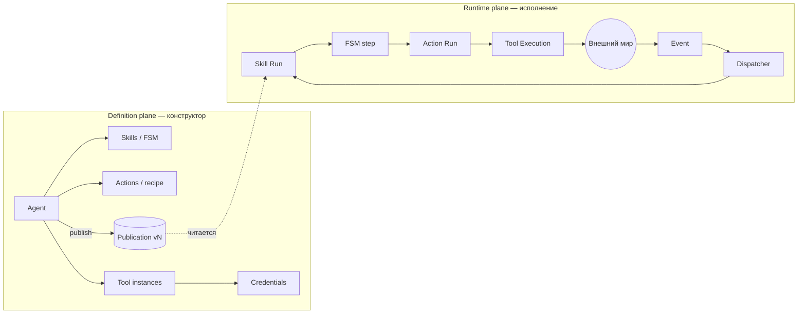
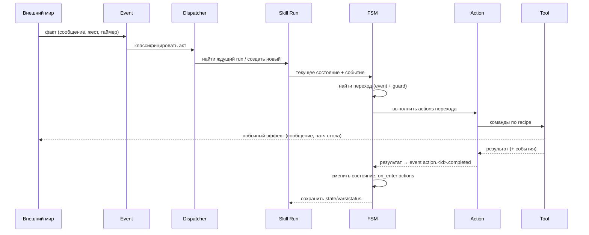

# Domain overview — модель предметной области

> Уровень: **Что / Из чего**. Описывает предметную область E.V.A. независимо от языка и фреймворков. Названия классов и файлов здесь не используются; где они нужны — см. [`04-code/`](../04-code/structure.md). Поведение описано **по коду** (источник истины); расхождения со спеками `docs_old/` помечены и собраны в [`REVIEW.md`](../REVIEW.md).

## Две плоскости

- **Definition plane** — то, что человек проектирует: агент, его навыки, операции, инструменты. Черновик редактируется свободно; **публикация** фиксирует неизменяемый снимок с версией.
- **Runtime plane** — то, что живёт: конкретные исполнения навыков (Skill Run), операций (Action Run), команд инструментов (Tool Execution), и события, которые их двигают. Runtime читает только публикации.

## Сущности определения

| Сущность | Что это | Ключевые свойства |
|---|---|---|
| **Agent** | Кто этот агент: композиция поведения и способностей | slug, имя, описание, `defaultSkillId`, skills[], actions[], tools[]; черновик; публикации; архивирован/нет |
| **Skill** | Процесс решения класса задач; описан конечным автоматом | id, версия, `initial`, params[], states[] |
| **State** | Где сейчас процесс | id, `on_enter[]` (actions при входе), `final`, transitions[] |
| **Transition (handler)** | Реакция состояния на событие | event type, guard (условие), actions[] (id операций), `to` (целевое состояние) |
| **Action** | Именованная операция агента; скрывает инструменты от FSM | id, версия, policy (`auto` / `needs_human`), recipe[], retry, timeout, on_failure |
| **Recipe step** | Один вызов команды инструмента внутри Action | id, tool (ссылка на инстанс или тип), command, input (с шаблонами), `when` |
| **Tool type** | Запись глобальной библиотеки: что умеет инструмент | id, commands[] со схемами полей, events[], configSchema, credentialKind/Policy |
| **Tool instance** | Подключение конкретного инструмента к агенту | id, toolId (тип), name, enabled, credentialId, config |
| **Credential** | Секрет для инстанса (токен бота, API-ключ, адреса/ключи веб-клиента) | id, toolId, name, зашифрованный секрет, meta |
| **Publication** | Неизменяемый снимок документа агента | версия `X.Y.Z` (patch автоинкремент), тело документа, дата |

## Сущности исполнения

| Сущность | Что это | Ключевые свойства |
|---|---|---|
| **Event** | Факт, что что-то произошло. Не команда | id, type, version, source, timestamp, correlation, payload, metadata, causation_id |
| **Skill Run** | Живой экземпляр Skill | id, skill id, пин версии публикации, current_state, status, params, vars, history[], revision, error |
| **Action Run** | Исполнение Action внутри Skill Run | status, input, output, current_step, attempt, deadline, error |
| **Tool Execution** | Один вызов команды инструмента внутри Action Run | tool instance, command, input, output, status, duration, attempt |
| **Tool API log** | Запись о вызове внешнего API инструментом (наблюдаемость) | tool, command, model, status, usage, превью запроса/ответа, ссылки на run/action/execution |
| **Timer schedule** | Отложенное событие для run | fire_at, event type, payload, fired |

## Сущности взаимодействия (человек ↔ агент)

Введены слоем Interaction (`docs_old/INTERACTION_SPEC_v0.1.md`), реализованы частично.

| Сущность | Смысл | Не путать с |
|---|---|---|
| **Разговор** (conversation) | Адрес нити: куда вернуть голос. `conversation_id` (Telegram chat, web `sessionId`) | Skill Run, скиллом |
| **Работа** (work) | Поручение в процессе = Skill Run, видимый человеку | Разговором: 1 разговор → 0..N работ |
| **Стол** (desk) | Правда дела: карточки, поля, статусы. Живёт во внешнем веб-клиенте | Историей чата, `vars` run |
| **Фокус** (focus) | Что человек имеет в виду *в этом акте*: открытая карточка, выделение, вид | «Разговором навсегда» |
| **Акт** (act) | Фраза, жест UI или входящий факт мира, адресованный агенту | Типом события как выбором скилла |
| **Диспетчер** | Классифицирует акт относительно открытых работ, фокуса и стола: resume / amend / start / side question / cancel / underspecified | Маршрутизатором «event.type → initial state» |
| **Присутствие** (presence) | Проекция открытых работ: чем агент занят, ждёт ли человека | Украшением UI |

## Главный цикл

Ключевые свойства цикла (все — **Fact** по коду):

1. Событие доставляется не «любому» run, а тому, чьё **текущее состояние объявляет переход на этот тип события**; иначе создаётся новый run подходящего Skill (или событие игнорируется).
2. Завершение каждой операции само становится событием `action.<id>.completed` с результатом в `payload.result`, и FSM может на него реагировать guard-ами.
3. Состояние без выхода и без `final` — это **ожидание**: run сохраняется как `waiting`, worker свободен.
4. Достижение `final` состояния завершает run (`completed`).
5. Любая необработанная ошибка операции переводит run в `error`; операция с политикой `needs_human` вместо ошибки переводит run в `waiting`, ожидая человека.

## Карта разделов домена

| Документ | Содержание |
|---|---|
| [`entities.md`](./entities.md) | Свойства, состояния и переходы состояний каждой сущности |
| [`mechanics.md`](./mechanics.md) | Механики: публикация и версии, маршрутизация, ожидание/возобновление, диспетчер, надёжность доставки, эффекты |
| [`algorithms.md`](./algorithms.md) | Алгоритмы: вычисление guard, шаблоны, разрешение ссылки на инструмент, выбор скилла, классификация акта, валидация |
| [`rules.md`](./rules.md) | Правила и инварианты с оценкой «держится / частично / нарушен» |
