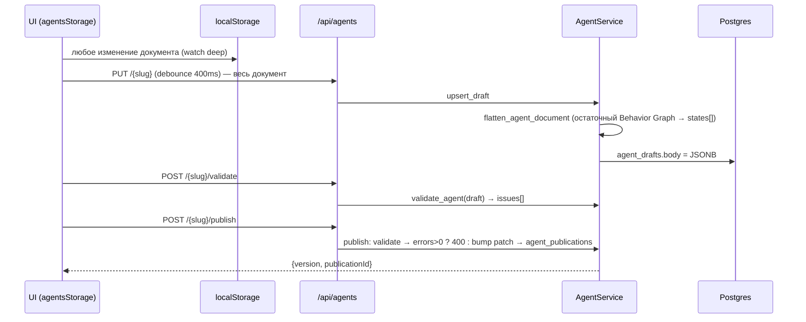
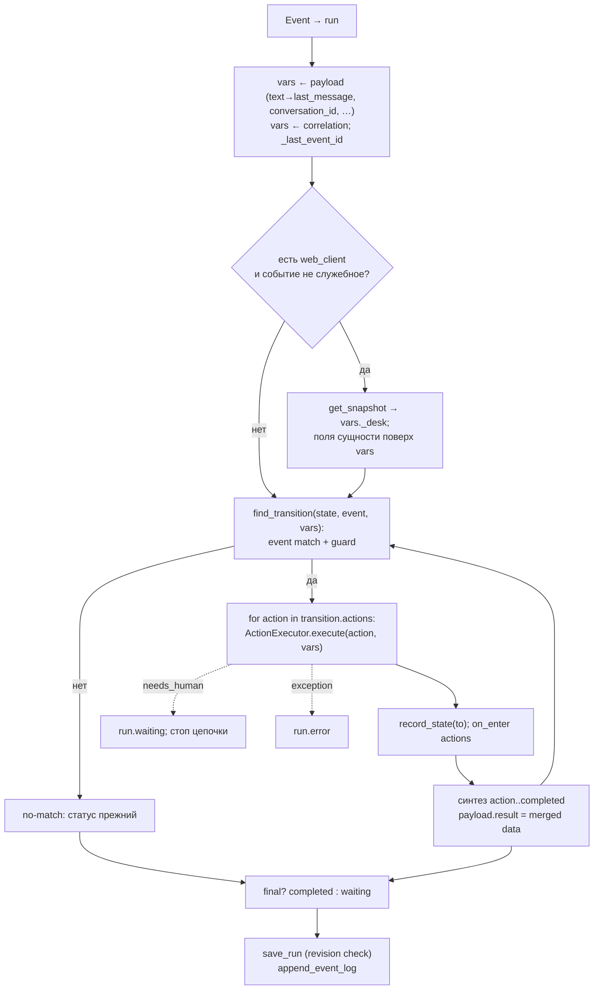

# Data flow — потоки данных и вызовов

> Уровень: **Как устроено**. Реальные пути данных по коду. Каждый поток — диаграмма + шаги с указанием, где данные меняют форму.

## F1. Проектирование: черновик → публикация



- Документ ездит целиком (skills, actions, tools) в camelCase; сервер не хранит Skill/Action отдельными строками.
- Публикация — копия `body` на момент publish; дальше её никто не меняет.

## F2. Входящее сообщение Telegram → ответ

```mermaid
sequenceDiagram
  participant TG as Telegram
  participant P as telegram_poller / webhook
  participant R as Redis Stream eva:events
  participant W as runtime_worker
  participant RS as RuntimeService
  participant T as TelegramTool
  TG->>P: update {message.chat.id, text}
  P->>P: normalize → {conversation_id: tg:chat:<id>, text}
  P->>P: resolve_skill_for_event(channel.message.received) → skillId
  P->>R: XADD {event envelope + agentSlug + skillId}
  W->>R: XREADGROUP
  W->>W: is_event_processed? → classify_act → lock key conv-skill:*
  W->>W: build_runtime_service(slug, skillId, pinned version?)
  W->>RS: route_all(event)
  RS->>RS: ждущий run с переходом на этот type? иначе новый run
  RS->>RS: vars ← payload; FSM step; actions
  RS->>T: send_message(chat_id, text)
  T->>TG: POST /bot<token>/sendMessage
  T-->>RS: ToolResult{data.sent, events:[channel.message.sent]}
  RS->>RS: action.<id>.completed → FSM; status; save run (revision++)
  W->>R: XADD channel.message.sent (вложенные события)
  W->>R: XACK; SADD processed_events
```

Форма данных: Telegram update → нормализованный payload → `Event` (конверт + correlation `conversation_id`) → wire JSON в поле `data` сообщения потока → `Event` в worker → `vars` run → args команды (после шаблонов) → HTTP к Bot API.

## F3. Акт веб-клиента: чат, кнопка, диспетчер

```mermaid
sequenceDiagram
  participant C as Веб-клиент (ai_supplier / stub)
  participant I as POST /api/channels/web/{slug}/events
  participant R as Redis
  participant W as runtime_worker
  participant D as Dispatcher
  participant RS as RuntimeService
  participant WCT as WebClientTool
  C->>I: Bearer inbound_api_key; {sessionId, type?, skillId?, actorId, focus, intent, entityIds, payload{text}}
  I->>I: verify key → credential → address with that credentialId<br/>payload += web_client_credential_id, web_client_address_id
  I->>I: normalize_web_act: actor→user_id, focus→metadata, entity_ids→entity_id
  I->>R: upsert snapshot сессии (lastMessage, focus, intent, …)
  I->>I: resolve skill (skillId / initial-state match / default); web.* принимаются без скилла
  I->>R: XADD event
  W->>D: classify_act(event, ждущие run разговора, тело публикации)
  D-->>W: DispatchDecision {kind, event (возможно rewrite type), resume_run_id, cancel_run_ids}
  W->>RS: route_all(prepared event)
  RS->>RS: cancel_run(ids) ; targets ; refresh_desk_snapshot (get_snapshot → vars._desk)
  RS->>WCT: send_message(session_id, text, workspace_update?, ui_proposal?)
  WCT->>WCT: meta.presence ← открытые run разговора
  WCT->>C: POST {base}/eva/messages {sessionId, text, meta}
  WCT->>R: LPUSH outbox
  C->>I: GET …/sessions/{id}/outbox (опционально, polling)
```

Ключевые преобразования: `sessionId` → `conversation_id`; `actorId` → `payload.actor_id`/`user_id`/`correlation.user_id`; `focus` → `payload.focus` и `metadata.focus`; фраза с намерением → **другой тип события** (rewrite) с `entity_ids`. Совпавший inbound-ключ добавляет в payload `web_client_credential_id` и, если адрес найден, `web_client_address_id`. Исходящий `POST {base}/eva/messages` берёт `base` из этого credential.

## F4. Шаг автомата и операции внутри run



Внутри `ActionExecutor.execute`:

```text
input = build_action_input(vars)                 // A10
ActionRun(running, deadline = now + timeoutMs)
for attempt in 1..max_attempts:
  for step in recipe:
    deadline? → timeout
    when (A1, scope шага) false → skip
    args = resolve_value(step.input, {input, vars, steps, payload})   // A2
    instance = resolve_tool_ref(step.tool)        // A3 (через тело агента)
    ToolExecutor.execute(instance, command, args, context, max_attempts)
       → defaults + validate input (mode) → tool.handle → ToolExecution → tool_api_logs
    steps[step.id] = {result: data}; merged.update(data); vars.update(data)
  → ActionResult(ok, merged, tool_calls, events)
on_failure: needs_human → waiting | fail → failed
```

## F5. Синхронный путь (dev / тесты / cockpit simulate)

```text
POST /api/runtime/runs {agentSlug, skillId, event}          → build_runtime_service(latest) → route(event) → RunResponse
POST /api/runtime/runs/start {agentSlug, skillId, params, event?, publicationVersion?}
                                                              → событие request.started (если event не задан) с payload = params
POST /api/runtime/events {skillRunId, type, payload}          → runtime по закреплённой версии run → route
POST /api/runtime/actions/execute {agentSlug, skillId, actionId, input}
                                                              → ActionExecutor напрямую, vars = input (без run)
POST /api/runtime/demo                                        → in-memory foreman happy path (EventRouter + stubs)
```

Отличия от шины: нет дедупликации, блокировок, DLQ, пина по ждущему run без `skillRunId`; диспетчер **применяется** (внутри `RuntimeService.route_all`), вложенные события инструментов **не публикуются** в шину (теряются). Используется UI simulate и большинством интеграционных тестов.

## F6. Чтение истории и cockpit

```text
GET /api/runtime/summary                 → skill_runs GROUP BY agent/status + публикации + archived
GET /api/runtime/agents/{slug}/summary   → то же для агента
GET /api/runtime/runs?agentSlug&skillId&status&activeOnly&limit&offset
GET /api/runtime/runs/{id}               → строка skill_runs (history, status, state)
GET /api/runtime/runs/{id}/history       → skill_run_events[] + action_runs[] { tool_executions[] }
GET /api/agents/{slug}/tool-logs?toolId&credentialId&status&limit  → tool_api_logs
POST /api/runtime/runs/{id}/cancel       → status cancelled; action_runs active → cancelled
POST /api/runtime/runs/{id}/replay?offset → повторная подача journal events в runtime (без защит)
```

## F7. Таймеры (как есть)

```text
timer_schedules(run_id, fire_at, event_type, payload, fired=false)   ← создаётся только программно (API/DSL нет)
runtime_worker после обработки любого события агента A, скилла S:
    process_due(A, S): выбрать fired=false и fire_at <= now (все! без фильтра по агенту) → publish_event(type, skill_run_id=run_id, agentSlug=A, skillId=S) → fired=true
```

**Fact.** Выборка due-таймеров не фильтруется по агенту: событие публикуется с `agentSlug`/`skillId` **текущего** события, а `skill_run_id` — целевого run. Worker при обработке возьмёт `agent_slug` из run (`vars._agent_slug`), так что доставка к правильному run вероятна, но ключ блокировки и пин могут вычисляться по чужому `agentSlug` — помечено в REVIEW как риск.

## F8. Бутстрап

```text
API lifespan:            init_db(): create_all → ALTER IF NOT EXISTS → seed_tool_catalog(BUILTIN_TOOLS) → prune_ephemeral_agents?
runtime_worker start:    ensure_consumer_group(eva:events, eva-runtime, id=0, mkstream)
frontend bootstrap:      GET /api/tools/catalog (кеш sessionStorage) → mount → agentsStorage: GET /health → GET /api/agents → GET /api/agents/{slug} ×N
                         если API недоступен: офлайн-режим на localStorage; если API пуст, а локально агенты есть → миграция local → API
```
