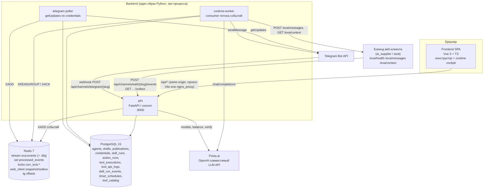
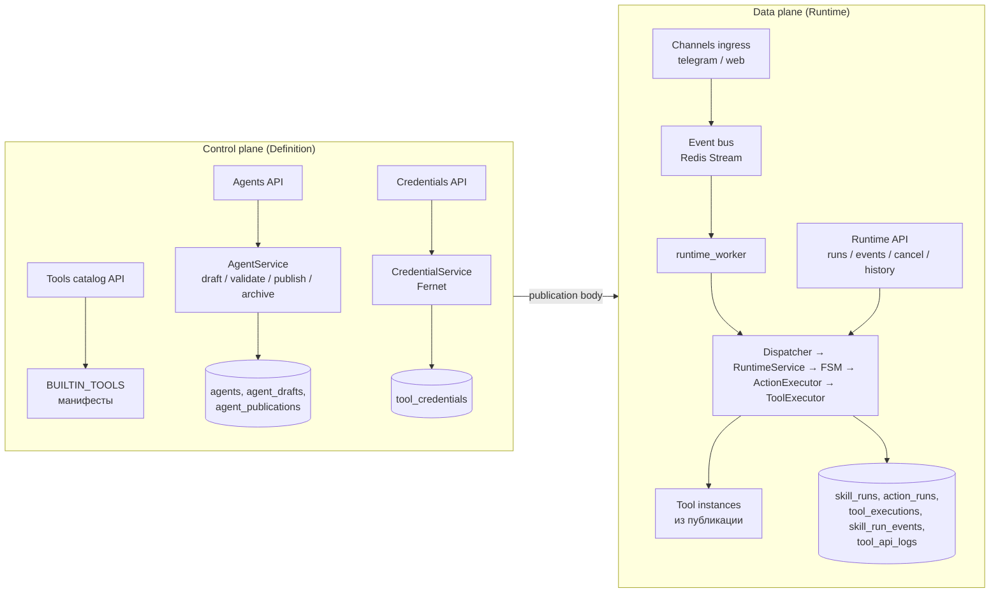

# Architecture overview — как доменная модель реализована системой

> Уровень: **Как устроено**. Компоненты, их границы и зависимости — по реальному коду и compose-файлам (не по целевой схеме из `architecture/backend_architecture_v1.md`; расхождения с ней отмечены).

## Система в целом



**Fact.** Backend — **модульный монолит**: один Python-пакет, один Docker-образ, три точки входа (`uvicorn app.main:app`, `python -m workers.runtime_worker`, `python -m workers.telegram_poller`). Это соответствует выбору `backend_architecture_v1.md` §2 («не микросервисы»).

## Control plane / Data plane



Граница между плоскостями — **публикация**: data plane собирает runtime (каталог Skill+Actions, реестр инстансов Tools с credentials) из тела публикации нужной версии при каждом событии (`runtime_factory`).

## Слои backend

```text
app/            HTTP: FastAPI app, роутеры, настройки, bootstrap БД
  └── depends on: definition, runtime, infrastructure
definition/     Определения: сервисы агентов/credentials/логов, валидация, мапперы документа → domain, каталог Tools и событий, flatten legacy Behavior Graph
  └── depends on: domain, infrastructure (ORM rows), runtime.tool_instance_resolver (!)
runtime/        Исполнение: диспетчер, маршрутизация, FSM, executors, фабрика runtime, locks, DLQ, scheduler, desk/presence
  └── depends on: domain, definition (мапперы, каталог), infrastructure (stores, redis), tools
infrastructure/ Postgres (ORM tables, session, stores), Redis (event bus, web client cache), crypto
  └── depends on: app.config (settings)
tools/          Реализации Tool-типов (пакет на тип) + base/registry/credential_resolver/scaffold
  └── depends on: domain, definition.catalog (события), infrastructure (логи, redis)
workers/        Долгоживущие процессы: runtime_worker, telegram_poller
  └── depends on: всё выше
domain/         Pydantic-модели: Agent/Skill/Action/Event/SkillRun/ActionRun/ToolExecution — без внешних зависимостей
```

Правило слоёв по `.cursor/rules/eva-backend.mdc`: `domain → definition → runtime → app / workers`. **Fact (отклонения):** `definition/validation/validate_agent.py` импортирует `runtime.tool_instance_resolver`; `infrastructure/db/session.py` и `infrastructure/redis/*` импортируют `app.config`. Циклов импорта это не создаёт (частично за счёт отложенных импортов внутри функций), но слои не строго односторонние — см. REVIEW.

## Frontend

```text
src/
  main.ts            → загрузить каталог Tools с API → смонтировать приложение
  router/            маршруты и legacy-редиректы; guard проверяет существование агента
  shared/            layout (AppShell, плавающее меню разделов), schema-driven форма по ToolFieldDef, утилиты
  features/
    agents/          список, карточка, overview (готовность к публикации), API-клиент, хранилище (localStorage + sync), валидация документа, world.addresses
    constructor/     стол: адреса, каналы внешнего мира, агент, навыки; каталог каналов
    skills/          FSM-холст (SVG), инспектор, тулбар, геометрия/маршрутизация, YAML import/export, валидация Skill, flatten legacy Behavior Graph
    actions/         список и редактор Action, редактор шагов recipe (schema-driven по каталогу), подсказки шаблонов
    tools/           библиотека типов (внешний мир / инструменты действий), инстансы агента, credentials, панели Polza/Web Client, логи вызовов
    runtime/         глобальный dashboard, cockpit агента, список/деталь run, timeline, simulate
    workspace/       оболочка агента: плавающее меню (Конструктор, Overview, Skills, Actions, Tools, Logs, Runtime)
```

Данные агента живут в реактивном store (`agents` ref) и зеркалируются в `localStorage` (`eva.agents.v2`); при доступном API черновики синхронизируются `PUT /api/agents/{slug}` с debounce 400 мс. Runtime-экраны ходят в API напрямую без локального кеша.

## Хранилища и их роли

| Хранилище | Данные | Срок жизни |
|---|---|---|
| PostgreSQL | весь control plane (агенты, черновики, публикации, каталог, credentials) и execution store (runs, action runs, tool executions, журнал событий run, логи API tools, таймеры) | постоянно (volume `postgres_data`) |
| Redis Stream `eva:events` + consumer group `eva-runtime` | очередь событий, PEL непод­тверждённых; `eva:events:dlq` | до ack / навсегда в DLQ |
| Redis SET `eva:processed_events` | дедупликация по `event.id` | без TTL (растёт) |
| Redis `eva:corr_lock:*` | распределённые блокировки | TTL 30 с |
| Redis `eva:web_client:{slug}:{session}` / `…:outbox:…` | кеш снимка стола (7 дней), исходящие сообщения клиенту (100 шт., 24 ч) | TTL |
| Redis `eva:tg:offset:{credential}` | offset long polling Telegram | без TTL |
| Redis `eva:msg_attempts:{message_id}` | счётчик попыток обработки сообщения потока | без TTL |
| Браузер `localStorage` / `sessionStorage` | черновики агентов (офлайн), кеш каталога Tools | пока не очищено |

## Что отличается от целевой схемы `architecture/backend_architecture_v1.md`

| Целевая схема | Реальность |
|---|---|
| таблицы `skills`, `skill_versions`, `actions`, `action_versions` | документ агента целиком в JSONB (`agent_drafts.body`, `agent_publications.body`) |
| `events` как event store в Postgres | только `skill_run_events` (журнал по run); шина — Redis Stream без долговременного хранения |
| отдельные `scheduler` / `event-worker` процессы | планировщик вызывается внутри `runtime_worker` после события |
| Memory service + pgvector | нет |
| Tool SDK как отдельный пакет `sdk/tool` | `tools/base.py` + `tools/scaffold.py` внутри backend |
| OpenTelemetry | нет; метрики — три счётчика in-memory |
| Auth JWT/OIDC | нет аутентификации API; CORS `*`; защищён только ingress веб-клиента (Bearer inbound key) |

Подробности компонентов — [`components.md`](./components.md); потоки — [`data-flow.md`](./data-flow.md); внешние системы — [`integrations.md`](./integrations.md).
